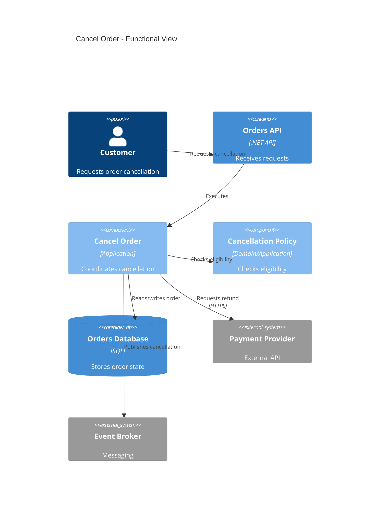

# Functional Use Case Analysis Guide

## Goal

Reconstruct one business functionality from entry point to observable output.

The specification is not a summary of one class.

It is a compact, evidence-backed explanation of how a business capability works.

## Discovery order

```text
Trigger
  ↓
Input payload
  ↓
Validation
  ↓
Use-case orchestrator
  ↓
Business collaborators
  ↓
Persistence / HTTP / Messaging
  ↓
Possible outputs
```

The orchestrator may be a Handler, UseCase, ApplicationService, Consumer, Processor,
or similar type.

## Finding the entry point

Look for:

- route mappings;
- controllers/actions;
- MediatR `Send`;
- use-case classes invoked directly;
- consumers;
- hosted/worker loops;
- scheduled jobs;
- event handlers;
- internal application calls.

One functionality may have more than one entry point.

Document all relevant ones.

## Finding business collaborators

Include services/decorators/policies that:

- decide whether an operation is allowed;
- calculate business values;
- change state;
- coordinate external business dependencies;
- enrich data needed for decisions;
- enforce business policies;
- control idempotency;
- select strategy/implementation.

Do not give equal weight to trivial technical helpers.

## Input extraction

Derive input fields from:

- Request/Command/Query/Event;
- route parameters;
- query string;
- headers when they affect behavior;
- body DTO;
- message contracts;
- validators.

Document business meaning and validation.

## Output extraction

Derive possible outputs from:

- Result branches;
- response mapping;
- HTTP status mapping;
- unions/discriminated outcomes;
- exceptions mapped by middleware;
- published events;
- retry/dead-letter flow;
- tests.

Do not document impossible theoretical outcomes.

Only include outcomes supported by code, requirements, or explicit desired behavior.

## Scenario extraction

Derive scenarios from:

- validators;
- guards;
- Result branches;
- switch/pattern matching;
- policies;
- service outcomes;
- repository lookups;
- external responses;
- exception handling;
- tests.

Prefer business language.

Bad:

> returns false when status equals 3

Better:

> cancellation is rejected when the order has already been invoiced

## Decomposition review

When inspecting the orchestrator, ask:

1. Can its business flow be explained in 5–10 concise steps?
2. Does each collaborator have a cohesive reason to exist?
3. Is infrastructure logic isolated?
4. Are business decisions independently testable?
5. Are there nested branches that represent distinct policies?
6. Are there multiple integration protocols in one method?
7. Does the class have too many unrelated dependencies?
8. Would extracting a service/policy/strategy reduce cognitive load?

Do not refactor simply because the method is long by line count.

Refactor when responsibilities are mixed or behavior becomes difficult to reason
about/test.

## C4 guidance

For functionality documentation, Component-level is usually appropriate.

Example:



## Drift detection

When a specification already exists, compare it against source.

Pay special attention to:

- changed payloads;
- changed output shapes/status codes;
- new dependencies;
- changed Result codes;
- new validation branches;
- changed external calls;
- new events;
- changed transaction boundaries;
- changed routes/triggers;
- renamed/extracted services;
- missing/renamed tests.
