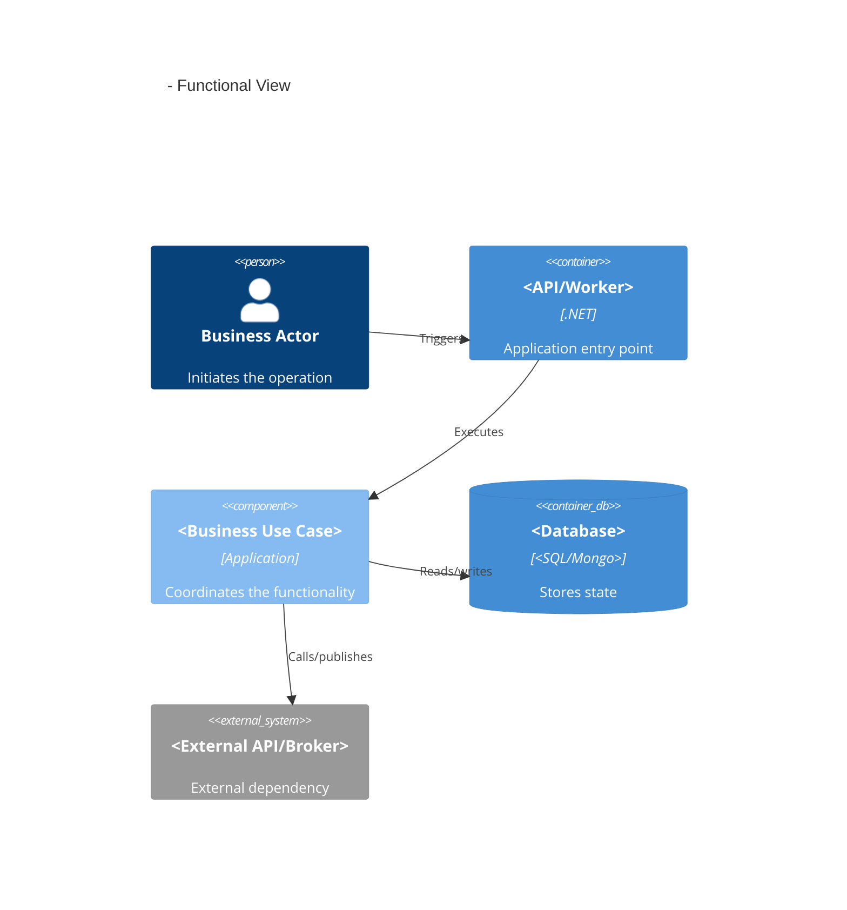

# <Business Functionality Title>

## Function

Describe in one short paragraph what this functionality coordinates from entry point
to observable outcome.

## Business objective

Explain why this functionality exists and the business result it delivers.

## Business language

| Term | Meaning in this functionality |
|---|---|
| | |

Use only terms that materially help a maintainer understand the business flow.

## Entry point

**Application:** `<Api / Worker / Library>`

**Trigger:** `<HTTP route / message / scheduled job / internal dispatch>`

**Use-case orchestrator:** `<Handler / UseCase / ApplicationService / Consumer / Processor>`

**Source location:** `<path>`

## Input payload

### Contract

`<Request / Command / Query / Event>`

### Example

```json
{
  "example": "representative-only"
}
```

### Fields

| Field | Required | Business meaning | Validation |
|---|---:|---|---|
| | | | |

For non-JSON/internal contracts, use an equivalent concise representation.

## Possible outputs

### Success

| Outcome | HTTP/Event/Result | Payload | Business meaning |
|---|---|---|---|
| | | | |

### Expected business failures

| Condition | HTTP/Event/Result | Payload | Side effects that must not occur |
|---|---|---|---|
| | | | |

### Exceptional / infrastructure failures

| Failure | External behavior | Retry/compensation | Observability |
|---|---|---|---|
| | | | |

## Success scenarios

### Scenario 1 — <business name>

**Given**

Describe the relevant business condition.

**When**

Describe the operation.

**Then**

Describe the observable business outcome, state changes, integrations, and returned
result.

## Expected business failure scenarios

### <business rejection>

**Given**

**When**

**Then**

**Result/response**

**Forbidden side effects**

## Exceptional / infrastructure scenarios

### <dependency or unexpected failure>

**Source**

**Expected technical behavior**

**Retry / compensation**

**Logs / metrics / traces**

## C4 — Functional view



Remove elements that do not participate.

Use the repository's existing C4 convention when one exists.

## Integrations

### External APIs

| Integration | Client | Operation | Request/Response role | Business purpose | Failure considerations |
|---|---|---|---|---|---|
| | | | | | |

### Messaging

| Direction | Message | Destination | Payload purpose | Business purpose | Delivery/idempotency |
|---|---|---|---|---|---|
| | | | | | |

### Databases

| Store | Repository/Context | Read/Write | Data involved | Transaction/consistency |
|---|---|---|---|---|
| | | | | |

### Other

Document cache/storage/other dependencies only when materially involved.

## Responsibility and decomposition assessment

### Current orchestration

Summarize the responsibilities currently owned by the use-case orchestrator.

### Complexity signals

- Long orchestration method:
- Too many dependencies:
- Mixed infrastructure/business logic:
- Repeated business conditions:
- Difficult-to-isolate tests:
- Other:

### Recommended decomposition

| Responsibility | Suggested abstraction/pattern | Why | Testing benefit | Trade-off |
|---|---|---|---|---|
| | | | | |

If no extraction is justified, explicitly state that the current responsibility
boundary is adequate.

## Risks

| Risk | Evidence | Impact | Mitigation / current control |
|---|---|---|---|
| | | | |

If no material risk is identified, state that explicitly.

## Business flow summary

1. ...
2. ...
3. ...

Keep this in business language.

## Test scenarios

| Scenario | Level | Arrange / Given | Act / When | Assert / Then |
|---|---|---|---|---|
| Success | Use-case unit | | | |
| Business rejection | Use-case/unit | | | |
| Infrastructure semantics | Integration/component | | | |

## Existing test coverage

### Covered

- ...

### Missing / weak

- ...

## Relevant code

- Entry point:
- Input contract:
- Output contract:
- Validator:
- Use-case orchestrator:
- Business services:
- Policies/specifications:
- Strategies/factories/decorators:
- Repository/data adapter:
- External client:
- Messaging:
- Tests:

## Maintenance notes

Record only non-obvious constraints, trade-offs, or sequencing details that future
maintainers must preserve.
